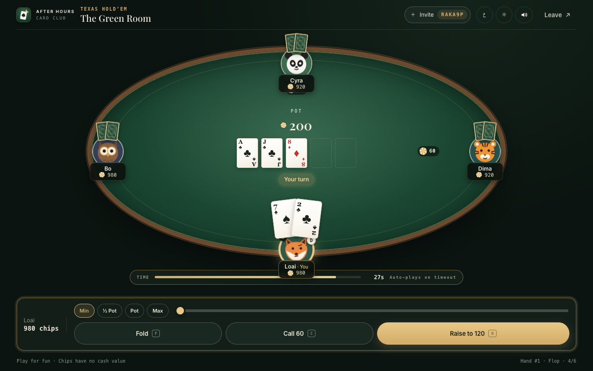

# After Hours — Card Club

A private, realtime card club for you and your friends. Spin up a table, share a link or QR code, and play **Texas Hold'em**, **Tarneeb**, or **Trix** from any device — no accounts, no downloads, no real money.

Built as an installable PWA on a [Convex](https://convex.dev) backend, so every seat at the table updates live.

[](https://github.com/loaikanou/after-hours-poker/actions/workflows/ci.yml)
[](LICENSE)



## Games

| Game | Players | Rules in brief |
| --- | --- | --- |
| **Texas Hold'em** | 2–6 | Blinds 10/20, no-limit betting with a raise slider (Min / ½ Pot / Pot / Max), all-ins with proper side pots, and correct heads-up blinds. Only hands that reach a contested showdown are revealed. |
| **Tarneeb** | 4 (2v2) | Bid 7–13 tricks; the first bidder must open. The winning bidder picks trump and leads. Make your bid and your team scores its tricks; fall short and you lose the bid while the defenders score theirs. First team to 31 wins. |
| **Trix** | 4 (solo) | Four kingdoms of five contracts — King of Hearts (−75), Diamonds (−10 each), Queens (−25 each), Collections (−15 per trick), and the Trix layout (200 / 150 / 100 / 50). Contracts end early once every penalty card is taken. Highest score after four kingdoms wins. |

Chips and scores are for fun only — there is no wagering, real money, or cash-out.

## Features

### At the table

- **Realtime everything** — seats, cards, pot, and turn order sync instantly through Convex subscriptions.
- **Characters** — pick one of eight illustrated animals; their faces react to play (thinking on the clock, grinning on a win, glum after a fold, dozing when away).
- **Animation & sound** — cards deal and fly in from each seat, tricks sweep to the winner, chips slide to the pot and back, confetti for big wins. Every sound is synthesized with Web Audio (no audio files) and can be muted.
- **You're always at the bottom** — seats rotate around you; Tarneeb partners sit across.
- **Turn timer** — 30 seconds per move, then the server plays a safe default. A ring counts down on the active player and your phone buzzes when it's your turn.
- **Drop-in / drop-out** — join a poker table mid-hand and you're dealt in next hand. Leave a trick game and the server plays your seat until someone takes it over. Busted poker players can rebuy.
- **Keyboard shortcuts** — `F` fold, `C` check/call, `R` raise.
- **Built for phones**: the game fits on one screen with no scrolling. The table grows to fill the space the controls leave, and turning the phone sideways switches to a table-plus-side-panel layout. Touch targets are at least 44 px, notches are handled, and taps give light haptic feedback.

### Around the table

- **Join by code or link** — every table has a 6-character code, shareable as a URL (`?table=CODE`), a QR code, or the native share sheet.
- **No accounts** — players are identified by a random key stored on the device.
- **Bilingual** — full English and Arabic UI with automatic right-to-left layout.
- **Light & dark themes** — follows the system preference by default.
- **Installable app** — see [PWA](#pwa) below.

## Tech stack

- **Frontend:** React 19, TypeScript 7, Vite 8 (Rolldown), hand-written token-based CSS
- **Backend:** Convex — queries, mutations, scheduled turn timers, an hourly cleanup cron
- **Tests:** Vitest 5 with `convex-test` and `@edge-runtime/vm`
- **Extras:** `qrcode` (loaded on demand) for invite codes; a build-stamped service worker
- **Hosting:** GitHub Pages or Vercel (static frontend) + Convex (backend)
- **CI/CD:** GitHub Actions — tests on every PR, automatic deploy from `main`

## Requirements

- Node.js **24 or newer** (`.nvmrc` pins 24)
- A [Convex](https://convex.dev) account (the free tier is fine)
- Google Chrome — only if you want to regenerate the icons

## Getting started

```bash
npm install
npm run dev     # terminal 1 — Convex backend (first run: log in and create/link a project)
npm run web     # terminal 2 — Vite dev server
```

The first `npm run dev` writes `CONVEX_DEPLOYMENT` and `VITE_CONVEX_URL` into `.env.local`. Open the URL Vite prints; if `VITE_CONVEX_URL` is missing, the app shows a setup screen instead of the lobby.

To try a multiplayer table on one machine, open the invite link in a second browser profile or a private window — each one gets its own player key.

## Scripts

| Script | What it does |
| --- | --- |
| `npm run dev` | `convex dev` — pushes backend functions and watches for changes. |
| `npm run web` | Vite dev server for the frontend. |
| `npm test` | Runs the Vitest suite once (`npm run test:watch` to keep it running). |
| `npm run typecheck` | Type-checks frontend and backend. |
| `npm run build` | Type-checks, then builds the frontend to `dist/` and stamps the service worker. |
| `npm run preview` | Serves `dist/` locally — the way to test the PWA and offline mode. |
| `npm run deploy` | Deploys backend functions to the production Convex deployment. |
| `npm run icons` | Regenerates every icon and the social share image `og-image.jpg`. Needs Chrome; set `CHROME=/path/to/chrome` if it isn't in the default macOS location. |

## Environment variables

The Convex CLI manages these in `.env.local` (git-ignored). Only `VITE_CONVEX_URL` is read by the app.

| Variable | Used by | Purpose |
| --- | --- | --- |
| `VITE_CONVEX_URL` | App | Convex deployment URL the client connects to. Inlined at build time. |
| `CONVEX_DEPLOYMENT` | Convex CLI | Which deployment `convex dev` / `convex deploy` target. |
| `VITE_CONVEX_SITE_URL` | Convex CLI | The deployment's HTTP-actions endpoint. Written automatically; unused by the app. |
| `CONVEX_DEPLOY_KEY` | CI / Vercel | Lets the deploy pipeline push the backend. Store it as a secret — see [Deployment](#deployment). |
| `BASE_PATH` | Build | Public path the site is served from. Defaults to `/`; the Pages workflow sets `/<repo>/`. |
| `SITE_URL` | Build | Absolute public URL, used for canonical links, social previews and the sitemap. The Pages workflow sets it, and on Vercel it falls back to the production domain. Without it, those URLs are relative and no sitemap is written. |

## Project structure

```
convex/
  schema.ts            The `tables` table, indexed by code and by last update
  tables.ts            Public API, turn timers, abandoned-table cleanup
  crons.ts             Hourly cleanup schedule
  model/               Pure game engine (no database access)
    types.ts           Validators and types: cards, players, events, avatars
    poker.ts           Hand evaluation, betting rounds, side pots
    trick.ts           Tarneeb and Trix rules
    state.ts           Table document <-> engine state
    errors.ts          Error codes thrown as ConvexError
  **/*.test.ts         Engine tests, full-match simulations, API tests
src/
  main.tsx             Preferences, Convex provider, service-worker registration
  App.tsx              Routing, mutations, optimistic card plays
  screens/             Lobby, invite, game table, status screens
  components/          Seats, characters, cards, controls, scoreboard, effects, install UI
  hooks/               Turn countdown, sound/animation effects, wake lock + turn badge
  lib/                 Web Audio synth, PWA store, session storage, formatting
  i18n.ts              English + Arabic strings; event and error localization
  styles.css           Design tokens, themes, layout, motion
public/
  manifest.webmanifest PWA manifest: icons, shortcuts, screenshots
  sw.js                Service-worker template (file list injected at build)
  favicon.svg          Tab icon
  icons/               App, maskable, Apple and shortcut icons (generated)
  screenshots/         Images shown in the install dialog
scripts/
  icons.mjs            Draws the icon family as SVG
  rasterize-icons.mjs  Renders the SVGs to PNG with headless Chrome
.github/
  workflows/ci.yml     Typecheck, tests, and both build layouts on every PR
  workflows/deploy.yml main → tests → Convex deploy → GitHub Pages
  dependabot.yml       Weekly npm and Actions updates
vite.config.ts         Build config, base path, service-worker stamping plugin
vercel.json            Vercel build command and cache/security headers
```

## How the backend works

Each table is one document in the Convex `tables` table: players, deck, board, bets, and per-game state (bids, trump, contracts, scores). Game rules live in `convex/model/` as plain functions over that state, which keeps them easy to test; `convex/tables.ts` loads a table, applies a move, and saves it in a single transaction.

| Function | Type | Purpose |
| --- | --- | --- |
| `tables.get` | query | A per-player snapshot. Other players' cards stay hidden except at a contested poker showdown, where only the hands still in are shown. |
| `tables.create` | mutation | Creates a table with a unique 6-character code; the creator hosts. |
| `tables.join` | mutation | Takes a seat. Poker players joining mid-hand sit out until the next deal; in trick games a newcomer can take over a seat someone left. |
| `tables.leave` | mutation | Frees the seat between hands, or hands it to the server mid-hand. Passes hosting on, and deletes the table when the last player leaves. |
| `tables.start` | mutation | Host deals the next hand / starts the match. |
| `tables.act` | mutation | Every in-game move: `fold`, `check`, `call`, `raise`, `allIn`, and `bid`, `pass`, `trump`, `play`, `selectContract` for the trick games. |
| `tables.rebuy` | mutation | Tops a busted poker player back up to 1,000 chips. |

- **Server-authoritative** — every move is re-validated (turn order, legality, amounts), so a modified client can't cheat.
- **Typed errors** — rule violations are thrown as `ConvexError({ code })`; the client translates the code.
- **Structured events** — each change records what happened (`{ kind: "raise", name, amount }`, …). The client turns it into a localized status line, sounds, and animations; the server never stores display text.
- **Turn timers** — each turn schedules an `autoAct` job 30 s out (1.5 s for a seat whose player left). It is cancelled as soon as the turn moves on.
- **Cleanup** — an hourly cron deletes tables untouched for 12 hours.

## PWA

The app installs to the home screen or desktop and works like a native app.

- **Install** — the Install button triggers the browser's own prompt on Chrome, Edge, and Android, and shows illustrated steps on iPhone/iPad. Returning visitors get one gentle suggestion, which "Not now" silences for two weeks.
- **Shortcuts** — long-press the app icon for *New poker / Tarneeb / Trix table*.
- **Offline** — the app shell, every code chunk, and the icons are cached, so the app opens without a connection and shows a banner until it reconnects.
- **Updates** — the app checks for a new version whenever it returns to the foreground and offers an **Update** button rather than reloading mid-hand.
- **At the table** — when installed, the app icon shows a badge on your turn; the screen stays awake while you're seated.

**How caching works.** `public/sw.js` is a template. On `npm run build`, the plugin in `vite.config.ts` writes the exact list of built files and a content-hash build ID into `dist/sw.js`. Each deploy therefore caches precisely what it shipped and removes the previous version's cache on activation — no version numbers to bump by hand.

| Request | Strategy |
| --- | --- |
| Page navigations | Network first (3.5 s timeout), cached shell when offline |
| `/assets/*` (hashed) | Cache first |
| Icons, manifest | Stale-while-revalidate |
| Google Fonts | Stale-while-revalidate, separate cache |
| Convex | Never intercepted |

The service worker only registers in production builds; use `npm run build && npm run preview` to test it.

## SEO and sharing

The app is a client-rendered single-page app. What crawlers and link scrapers see therefore has to be in `index.html` itself:

- **Link previews**: Open Graph and Twitter tags with a 1200×630 card (`public/og-image.jpg`, under WhatsApp's size limit), `og:locale` for English and Arabic, and absolute URLs filled in at build time.
- **Search**: a keyword-focused title and description, a canonical URL, `hreflang` alternates (`?lang=ar` opens the Arabic version), and `WebApplication` structured data (JSON-LD).
- **Crawlable content**: `#root` ships with real text (headline, description, the list of games). It's what scrapers see without JavaScript, and it doubles as the loading splash.
- **Privacy**: invite and table links (`?table=CODE`) are excluded in `robots.txt`, and those screens set `noindex` at runtime. Shared games never show up in search.
- **Build output**: the `seo` plugin in `vite.config.ts` fills the placeholders and writes `robots.txt` and `sitemap.xml` (the sitemap only when `SITE_URL` is known).
- **Per-screen titles**: for example "The Green Room · Tarneeb — After Hours".
- **Sharing**: invites carry a descriptive message, such as *Join my Tarneeb table "The Green Room" on After Hours — code 95SFD8*. They can go out through the native share sheet or one-tap WhatsApp, Telegram and email links. The lobby footer can share the club itself.
- **Speed**: fonts load without blocking rendering.
- **Lighthouse (mobile)**: SEO 100, Accessibility 100, Best Practices 100, Performance 98.

After the first deploy, check the preview with the [Facebook Sharing Debugger](https://developers.facebook.com/tools/debug/) or [opengraph.xyz](https://www.opengraph.xyz/), and submit `sitemap.xml` in [Google Search Console](https://search.google.com/search-console). For a GitHub Pages *project* site, crawlers only read `robots.txt` at the domain root. Submit the sitemap through Search Console, or use a custom domain.

## Testing

```bash
npm test
```

- `convex/model/poker.test.ts` — hand rankings, side pots, blinds, minimum raises, fold-outs.
- `convex/model/trick.test.ts` — plays complete Tarneeb hands and matches, and a full four-kingdom Trix tournament, checking that scores add up.
- `convex/tables.test.ts` — the API through `convex-test`: card privacy, host-only actions, error codes, server auto-play on timeout, leaving and table cleanup.

## CI/CD

Two GitHub Actions workflows live in `.github/workflows/`:

| Workflow | Runs on | What it does |
| --- | --- | --- |
| **CI** (`ci.yml`) | Pull requests, pushes to other branches, manual | `npm ci` → typecheck → tests → build at the root **and** under a Pages subpath → checks the service worker was stamped. |
| **Deploy** (`deploy.yml`) | Pushes to `main`, manual | Runs CI first. If it passes: deploys the Convex functions to production, builds the site against that deployment, and publishes it to GitHub Pages. |

Deploys never cancel each other mid-way; a newer push waits for the running one. Dependabot opens weekly PRs for npm packages (minor and patch updates grouped into one) and for the Actions themselves, and CI tests each one.

## Deployment

The frontend is a static bundle, and the backend is Convex. Every deploy runs `npx convex deploy --cmd 'npm run build'`, which pushes the functions to the production deployment and then builds the frontend against that same deployment. As a result, the client and the server always match.

You'll need a **Convex production deploy key** for any option: in the [Convex dashboard](https://dashboard.convex.dev/), open your project's production deployment → *Settings → General* → *Generate Production Deploy Key*, with the `deployment:deploy` permission.

### GitHub Pages (via GitHub Actions)

The site works as a Pages project site (`https://<user>.github.io/<repo>/`) or with a custom domain. The base path is detected automatically.

1. **Settings → Pages → Build and deployment → Source:** choose **GitHub Actions**.
2. **Settings → Environments → New environment** named `production`. Add the secret **`CONVEX_DEPLOY_KEY`** with your production deploy key. Optionally, restrict the environment to the `main` branch or require a reviewer.
3. Push to `main`, or run **Deploy** manually from the *Actions* tab. The published URL appears on the `github-pages` environment.

Why it works on Pages:
- The app uses `?table=CODE` query strings rather than client-side routes, so there are no 404s to work around.
- Every public URL, plus the service worker's scope and cache list, is built from `BASE_PATH`.
- The manifest uses relative URLs.

Pages can't set custom headers, but nothing depends on them: the service worker is registered with `updateViaCache: "none"`, so new versions are always picked up.

### Vercel

[vercel.json](vercel.json) is already configured; you only need the deploy key.

1. **Add the key to Vercel**: *Settings → Environment Variables* → `CONVEX_DEPLOY_KEY`, scoped to **Production**. For backend previews per branch, also add a *Preview* deploy key, scoped to **Preview**.
2. **Deploy**: connect the project to the GitHub repository so Vercel redeploys on every push, or run:

   ```bash
   npx vercel --prod
   ```

Vercel runs:

```bash
npx convex deploy --cmd 'npm run build' --cmd-url-env-var-name VITE_CONVEX_URL
```

`convex deploy` sets `VITE_CONVEX_URL` to the production URL for the duration of the build, so you don't set it yourself. The `--cmd-url-env-var-name` flag matters: Convex's default variable is `CONVEX_URL`, which this app doesn't read.

`vercel.json` also sets the caching rules the PWA depends on: hashed assets are immutable, `sw.js`, `index.html`, and the manifest are always revalidated, and icons are cached for a week. It adds basic security headers too.

> **Both at once?** It's safe for GitHub Pages and Vercel to deploy the same `main`. Both push identical functions to the same Convex deployment. If you only want one frontend, disable the other: turn off Vercel's Git integration, or delete `deploy.yml`.

### Other static hosts

```bash
npm run deploy                                                    # backend
VITE_CONVEX_URL=https://<your-prod-deployment>.convex.cloud npm run build   # frontend
```

Serve `dist/` from any static host (Netlify, Cloudflare Pages, …). If the site lives under a subpath, build with `BASE_PATH=/your/path/`. For the PWA to update reliably, serve `sw.js` and `index.html` with `Cache-Control: no-cache`.

## Troubleshooting

- **Setup screen instead of the lobby** — `VITE_CONVEX_URL` is missing. Run `npm run dev` once, then restart `npm run web`.
- **An old version keeps loading after a deploy** — the installed app shows an *Update* toast; tap it. In a browser tab, closing every tab of the app also picks up the new version.
- **Deploy workflow fails at "Check for the Convex deploy key"**: add `CONVEX_DEPLOY_KEY` to the `production` environment's secrets. It goes there, not under repository variables.
- **Deploy workflow fails at "Configure GitHub Pages" with "Get Pages site failed" / "Resource not accessible by integration"**:
  - Pages isn't enabled for Actions yet. Set *Settings → Pages → Build and deployment → Source* to **GitHub Actions**, then re-run the workflow.
  - On a **private** repository, Pages needs a paid GitHub plan (Pro, Team or Enterprise). Otherwise, make the repository public or deploy with Vercel instead.
- **No sound** — browsers allow audio only after you interact with the page; tap anywhere once. Check the speaker toggle in the top bar.
- **Install button does nothing on desktop Safari or Firefox** — those browsers have no install prompt; the button shows instructions instead.

## Notes for contributors (and AI agents)

- Read `convex/_generated/ai/guidelines.md` before changing backend code — those rules override general Convex knowledge.
- Keep game rules in `convex/model/` as pure functions and cover them with tests; `convex/tables.ts` should stay a thin layer that loads, applies, and saves.
- New UI text goes in both languages in `src/i18n.ts`; the `ar` table is type-checked against `en`, so a missing key fails the build.
- Local `AGENTS.md` / `CLAUDE.md` files (git-ignored) repeat the Convex instruction for agentic tools.

## Author

**Loai Kanou** — [github.com/loaikanou](https://github.com/loaikanou)

Bug reports and ideas are welcome in [Issues](https://github.com/loaikanou/after-hours-poker/issues).

## License

[MIT](LICENSE) © 2026 Loai Kanou

This licence covers the code, the generated icons, and the character and card artwork in this repository. The fonts (Inter, Playfair Display, El Messiri) are loaded from Google Fonts under the SIL Open Font License, and npm dependencies keep their own licences.
